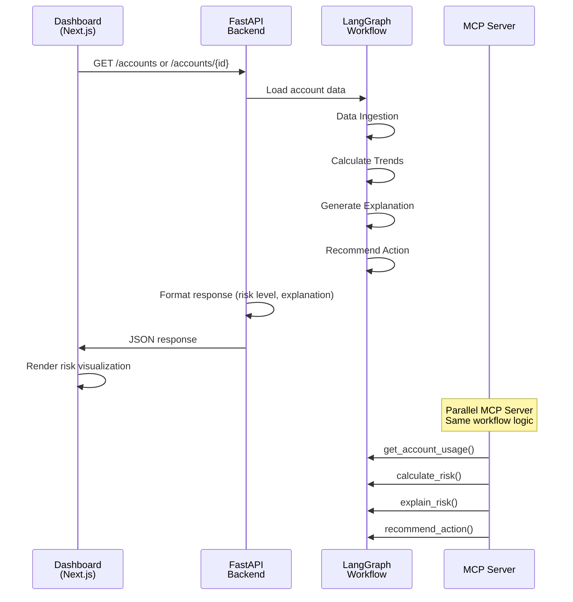
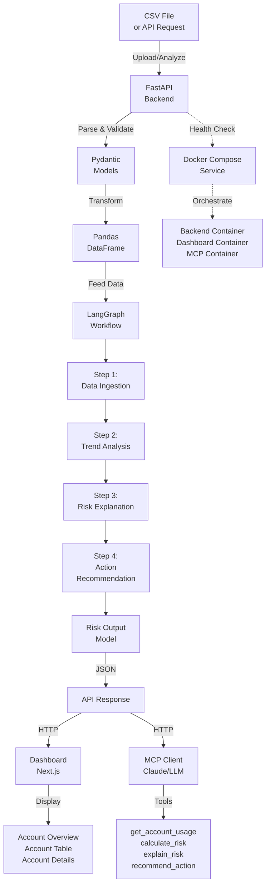

# Vantage Churn Early Warning System

The goal is to help Vantage Retail Systems Customer Success spot declining account engagement early and decide when to follow up. The system uses explainable weekly-login signals as an early-warning proxy; it does not predict whether or when an account will churn. Its risk levels describe usage patterns, not confirmed churn outcomes.

## What this project is (and is not)

This is a demo early-warning system: it applies shared, transparent rules to synthetic weekly login histories to highlight declining engagement and suggest a follow-up action. The sample accounts are not real companies, and their histories do not represent company-specific parameters.

It is not a churn prediction model. It has no labeled churn or renewal outcomes, does not estimate a churn probability or date, and has not been validated against actual customer outcomes. A risk level is a usage signal for human review, not proof that an account will churn.

### Turning it into a churn prediction model

Building a predictive model would require historical customer data linked to clearly defined churn or renewal outcomes. Define the outcome and prediction horizon, assemble features available before that outcome, and prevent future information from leaking into training. Train and compare a baseline model, evaluate it on a time-based holdout using metrics suited to the business and class balance, then validate its usefulness with Customer Success before any operational use. Add privacy and access controls, monitoring for data and model drift, and a human review process. Until that work is done, treat this project’s scores as heuristic engagement signals only.

## Start the application

Requirements: Rancher Desktop with the `dockerd (Moby)` container engine and Docker Compose. In Rancher Desktop, select **dockerd (Moby)** under **Container Engine**, apply the setting, and restart Rancher Desktop. Verify the CLI and Compose plugin are available:

```powershell
docker version
docker compose version
```

```sh
docker compose up --build
```

Keep this terminal open while the services run.

- Dashboard: <http://localhost:3000>
- API: <http://localhost:8000>
- OpenAPI / Swagger UI: <http://localhost:8000/docs>
- MCP streamable HTTP: <http://localhost:8001/mcp>

Stop the services with `Ctrl+C`, then remove the containers with:

```sh
docker compose down
```

If Rancher Desktop uses `containerd`, use `nerdctl compose` instead of `docker compose` if that command is available in your installation.

## Sequence Diagram

The following diagram shows how the Dashboard, API, and LangGraph Workflow interact to analyze account risk:



## System Flow Diagram

The following diagram illustrates the complete data flow through the system:



## Activity Flow Diagram

The following diagram shows the step-by-step activities when analyzing an account:

```mermaid
flowchart LR
    Start([User/System]) -->|Request Account Analysis| API[FastAPI Endpoint]
    API -->|Fetch Data| DB[Load CSV/Cache]
    DB -->|Weekly Login Data| Parse["Parse & Validate<br/>CSV Data"]
    
    Parse -->|Valid Data| IngestionStep["🔵 LangGraph:<br/>Data Ingestion"]
    Parse -->|Invalid| ErrorResp["Return Error 422"]
    ErrorResp --> End1([End])
    
    IngestionStep -->|Extract Signals| TrendStep["🟢 LangGraph:<br/>Trend Analysis"]
    TrendStep -->|Compute Metrics| Metrics["• Login Rate Change<br/>• Volatility<br/>• Insufficient Data Check"]
    
    Metrics -->|Analyze Patterns| RiskStep["🟡 LangGraph:<br/>Risk Classification"]
    RiskStep -->|Apply Rules| RiskClass["Risk Level:<br/>Healthy/Watch/<br/>At Risk/Critical"]
    
    RiskClass -->|Explain| ExpStep["🟠 LangGraph:<br/>Explanation Generation"]
    ExpStep -->|Reason| Reason["Why this risk level?<br/>What changed?"]
    
    Reason -->|Recommend| ActionStep["🔴 LangGraph:<br/>Retention Action"]
    ActionStep -->|Suggest| Action["Recommended Action:<br/>Monitor/Escalate/<br/>High Touch/Critical Alert"]
    
    Action -->|Compile| Response["Return Response:<br/>account_id, risk_level,<br/>explanation, action"]
    Response -->|Serialize| JSON["JSON to<br/>Dashboard/MCP"]
    JSON --> End2([End - Display/Use Results])
```



## Tech Stack

### Backend
- **Framework**: FastAPI (Python 3.12+)
- **Server**: Uvicorn with standard extras
- **Data Processing**: Pandas, Pydantic
- **Workflow**: LangGraph
- **Testing**: Pytest, pytest-cov
- **HTTP Client**: httpx

### Frontend
- **Framework**: Next.js 15.x
- **UI Library**: React 19.x
- **Language**: TypeScript 5.7+
- **Styling**: Custom CSS (no Tailwind)

### MCP Integration
- **Model Context Protocol**: MCP 1.0+
- **Tools**: HTTP streamable tools backed by LangGraph workflow

### DevOps & Containerization
- **Container Runtime**: Docker & Docker Compose
- **Container Engine**: Moby (Rancher Desktop)

### Testing & Quality
- **Backend Tests**: Pytest with 80%+ coverage requirement
- **Frontend Build**: Node.js 20+
- **CI/CD**: GitHub Actions

## Architecture

- `backend/`: FastAPI API, Pandas CSV ingestion, Pydantic models, scoring, explanation, and retention playbook.
- `agents/`: sequential LangGraph workflow: Data → Trend → Explanation → Retention.
- `mcp-server/`: MCP tools backed by the same workflow and domain rules.
- `frontend/`: Next.js dashboard with overview, account table, and account detail views.
- `tests/`: Pytest domain, ingestion, API, and workflow tests.
- `docs/architecture.md`: assumptions, risk definitions, decisions, and tradeoffs.

The dashboard calls the API from the browser. The API and MCP server share the LangGraph workflow and deterministic domain logic. No language model makes or alters risk decisions. The dashboard uses local CSS rather than Tailwind.

## API

| Method | Endpoint | Purpose |
|---|---|---|
| GET | `/accounts` | All account reports and weekly history |
| GET | `/accounts/{id}` | One account report |
| GET | `/risk-summary` | Total and per-level counts |
| GET | `/high-risk` | At Risk and Critical accounts |
| POST | `/analyze` | Analyze CSV provided as `{"csv_content":"..."}` |

CSV columns: `account_id,week_start,login_count`. Invalid or null values return HTTP 422. OpenAPI is served at `/openapi.json`.

### Smoke test

With the services running, use PowerShell to check health, sample data, and an account report:

```powershell
Invoke-RestMethod http://localhost:8000/healthz
Invoke-RestMethod http://localhost:8000/risk-summary
Invoke-RestMethod http://localhost:8000/accounts/VNT-004
```

The active API sample has 17 synthetic accounts. `VNT-004` should be Critical; `VNT-007` and `VNT-008` should be Insufficient Data. `VNT-017` has steadily increasing logins and should be Healthy. The risk summary should report 6 Healthy, 3 Watch, 4 At Risk, 2 Critical, and 2 Insufficient Data accounts.

To test CSV analysis, open `/docs`, expand `POST /analyze`, select **Try it out**, and submit:

```json
{
  "csv_content": "account_id,week_start,login_count\nT-1,2026-08-31,100\nT-1,2026-09-07,100\nT-1,2026-09-14,100\nT-1,2026-09-21,100\nT-1,2026-09-28,50\nT-1,2026-10-05,50\nT-1,2026-10-12,50\nT-1,2026-10-19,50"
}
```

The response should classify `T-1` as `At Risk` and include an explanation and recommended action.

## MCP connection

Start with `docker compose up --build`, then configure an MCP client for streamable HTTP at `http://localhost:8001/mcp`. For clients using JSON configuration:

```json
{
  "mcpServers": {
    "vantage-churn": {
      "url": "http://localhost:8001/mcp"
    }
  }
}
```

Tools: `get_account_usage(account_id)`, `calculate_risk(account_id)`, `explain_risk(account_id)`, and `recommend_action(account_id)`.

## Tests

Python 3.12 is required for backend tests:

```sh
python -m pip install -r backend/requirements.txt
python -m pytest
```

Pytest enforces at least 80% coverage for `backend.app` and `agents`. To build the dashboard:

```sh
cd frontend
npm ci
npm run build
```

The root Node.js prototype has separate tests. Run `npm test` from the repository root; these tests do not cover the Compose application.

## Dashboard Features

### Dynamic Content by Time Period 📅

The dashboard displays dynamic content based on selected time periods. Users can analyze account risk data across different time windows:

**Available Time Periods:**
- Last 1 week
- Last 4 weeks (default comparison window)
- Last 8 weeks (default dashboard view)
- Last 12 weeks
- All history

**Time Period Selector:**
Located in the top-right header next to "Weekly usage analysis". The dropdown allows instant switching between periods without page reload.

**Dynamic Metrics Calculation:**

When a time period is selected, the following metrics recalculate for each account:

| Metric | Calculation | Usage |
|--------|-------------|-------|
| **Recent Average** | Sum of logins for selected period / number of weeks | Current period baseline |
| **Previous Average** | Sum of logins for same duration before selected period / number of weeks | Comparison baseline |
| **Decline Percent** | `(Previous Avg - Recent Avg) / Previous Avg × 100` | Risk indicator |
| **Trend Slope** | `(Last week logins - First week logins) / (weeks - 1)` | Direction indicator |

**Dynamic Risk Recalculation:**

Risk levels are reassigned based on period-specific metrics:

```
Insufficient Data: < 4 data points in selected period
Healthy:           Stable or growing logins
Watch:             10-15% decline OR slight negative trend
At Risk:           15-25% decline OR negative trend with >10% decline
Critical:          >25% decline OR steep negative trend with >15% decline
```

**Views Affected:**

1. **Risk Overview**
   - Metric cards update to show account counts per risk level for selected period
   - "Accounts needing attention" list filters by period-specific risk levels
   - Signal explanation updates to reference the selected period duration

2. **Account Risk Table**
   - Column headers dynamically show period context ("Prior period avg", "Recent period avg")
   - All accounts sorted by period-specific decline percentage
   - Risk badges reflect period-recalculated risk levels

3. **Account Detail**
   - Trend chart displays only weeks in selected period
   - Chart scales adjust to selected period's min/max login values
   - All statistics (decline %, trend slope) calculated for period
   - Account history shows "X weeks in period" instead of total account age

**Implementation:**

- **State:** `timePeriod` holds current selection; defaults to "8w"
- **Filtering:** `filteredAccounts` memoized hook recalculates all metrics when period changes
- **Performance:** Uses React memoization to avoid unnecessary recalculations
- **Persistence:** Time period selection persists when navigating between overview/table/detail views

### Configuration-Driven Labels 🎛️

All labels, messages, and legends are centralized in a `CONFIG` object at the top of `frontend/src/app/page.tsx`. This allows changes without modifying component logic.

**CONFIG Structure:**

```javascript
const CONFIG = {
  api: "http://localhost:8000",
  
  labels: {
    // Page labels and headings
    brand: "VANTAGE RETAIL SYSTEMS",
    mainTitle: "Churn early warning",
    // ... 30+ labels
  },
  
  timePeriods: [
    { value: "1w", label: "Last 1 week", weeks: 1 },
    // ... more periods
  ],
  
  riskLevels: ["Healthy", "Watch", "At Risk", "Critical", "Insufficient Data"],
  
  riskThresholds: {
    criticalDecline: 25,
    criticalTrendSlope: -5,
    atRiskDecline: 15,
    atRiskTrendSlope: -2,
    watchDecline: 10,
    minDataPoints: 4,
  },
  
  accountNames: {
    "VNT-001": "Northstar Outfitters",
    // ... 17 accounts
  },
  
  errors: {
    loadFailed: "Could not load account data: ",
    loading: "Loading account signals…",
  },
  
  chart: {
    width: 720,
    height: 220,
    padding: 28,
  },
};
```

**How to Update Labels:**

Instead of searching code, simply modify the `CONFIG.labels` object:

- **Change "Prior 4-week avg" display**: Update `CONFIG.labels.priorPeriodAvg`
- **Change error messages**: Update `CONFIG.errors.*`
- **Change risk thresholds**: Update `CONFIG.riskThresholds.*`
- **Change account names**: Update `CONFIG.accountNames.*`

All changes automatically propagate throughout the dashboard without touching component logic.

## Repository notes

- Source repository: [github.com/manish2307github/vintageSystemCheck](https://github.com/manish2307github/vintageSystemCheck).
- `docs/architecture.md` records risk assumptions, thresholds, workflow, and tradeoffs.
- `backend/data/weekly_usage.csv` contains synthetic usage histories for 16 demo accounts, not data from 16 real companies. The histories exercise different patterns, risk-band boundaries, and data-quality cases, but every account is scored using the same rules and thresholds; there are no company-specific parameters. This is demo and test data, not labeled churn training data or evidence of predictive accuracy.
- The root `src/` and `test/` directories contain a pre-existing Node.js prototype. It uses `data/seed.json`, Compose does not run it, and its scoring rules differ from the Python service.
- `.github/workflows/ci.yml` runs backend tests, dashboard build, legacy prototype tests, and a Compose end-to-end smoke test on pushes and pull requests.
- The MCP endpoint has no authentication. Keep it on a trusted local network; do not expose it publicly without access controls.
- Do not commit credentials, `.env` files, or generated build output.
