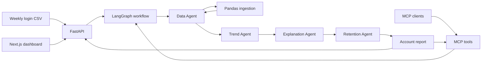

# Architecture and business assumptions

## Problem

The goal is to help Vantage Retail Systems Customer Success notice declining account engagement early enough to consider a follow-up. The system provides a transparent usage-based warning signal; it does not predict whether or when an account will churn. There are no churn labels, renewal outcomes, or validated definition of “at risk,” so risk levels describe observed usage patterns rather than churn outcomes.

## What this project is (and is not)

This is a demo early-warning system that applies the same deterministic rules to synthetic weekly-login histories to flag declining engagement and suggest a retention action. The 16 sample accounts are not real companies, and the data does not encode company-specific parameters.

It is not a churn prediction model: it has no labeled churn or renewal outcomes, estimates neither churn probability nor timing, and has not been validated against actual customer outcomes. A risk level reflects the observed usage pattern only; it is not evidence that an account will churn.

To develop a predictive model, first define a measurable churn or renewal outcome and a prediction horizon. Collect representative historical customer records joined to those outcomes, with feature snapshots limited to information available at the prediction time to avoid leakage. Establish a baseline, compare models using time-based holdout data and business-relevant metrics, and validate the results with Customer Success before deployment. Production use would also require privacy and access controls, ongoing monitoring for data/model drift, and human review of recommendations.

## Data path

CSV ingestion validates `account_id`, `week_start`, and non-negative integer `login_count`. It rejects blank or null required values, invalid dates, duplicate account/week pairs, and dates not aligned to a seven-day cadence. Rows are sorted per account. Missing whole weeks are recorded, not imputed. Account age is the inclusive span from its first observed week to its last.

The Data Agent validates CSV into `AccountUsage`. Trend Agent calculates averages, decline, and least-squares slope. Explanation Agent gives the evidence and threshold. Retention Agent selects a fixed playbook action. LangGraph runs these stages in sequence. The same deterministic functions serve the API and MCP tools.

## Risk definitions

At least 8 consecutive weekly observations are required. Compare the first 4 observations in the latest 8 against the latest 4:

`decline_percent = (previous_average - recent_average) / previous_average * 100`

| Risk | Decline |
|---|---:|
| Healthy | Less than 15% |
| Watch | 15% to less than 30% |
| At Risk | 30% through 50% |
| Critical | Greater than 50% |
| Insufficient Data | Fewer than 8 consecutive observations |

Threshold boundaries are intentionally non-overlapping. If previous average is zero, decline is defined as 0%; percentage decline is undefined from a zero baseline. Missing weeks inside the latest 8 make the score Insufficient Data. Older missing weeks do not invalidate a complete latest 8-week window.

Trend slope is ordinary least-squares logins per week across the latest 8 observations. Confidence is a heuristic score, not a calibrated probability: start at 60, add up to 20 based on decline magnitude, and add 15 for a negative slope, capped at 100. Insufficient Data has confidence 0.

## Explainability and retention

Every report includes prior/recent averages, percentage decline, slope, confidence, risk, explanation, action, priority, and Customer Success notes. Actions are fixed by risk level:

| Risk | Recommended action | Priority |
|---|---|---|
| Healthy | Monitor normally | Low |
| Watch | Send customer health check | Medium |
| At Risk | Customer Success outreach | High |
| Critical | Immediate executive engagement | Urgent |
| Insufficient Data | Collect more weekly usage history | Low |

## Design decisions and tradeoffs

- Rules are used instead of an ML model because no churn labels or other customer context are available. This favors auditability over predictive claims.
- A declining slope raises confidence, but the application reports it as a heuristic. Login count alone cannot identify cause or prove churn intent.
- Missing data is surfaced instead of silently filled. This avoids inventing engagement activity.
- The API reads `backend/data/weekly_usage.csv` as its sample source. `/analyze` accepts CSV without persisting it; production ingestion should use durable storage and access controls.
- The active sample contains synthetic usage histories for 16 demo accounts with 6 to 12 observations each; these are not 16 real companies. The histories cover every risk band, exact 15%, 30%, and 50% boundaries, a decline above 50%, a zero baseline, and insufficient or gapped history. All accounts use the same scoring rules and thresholds, not company-specific parameters. This is demo and test data, not labeled churn data or evidence of predictive accuracy.
- The dashboard is a small Next.js client app with an SVG trend chart. It uses no charting service or hosted font.
- LangGraph provides a clear sequential agent boundary. Agents remain deterministic; there are no unbounded model calls or autonomous customer outreach.
- MCP tools expose the same analysis. The included MCP endpoint has no authentication and is intended for local development; deploy behind authenticated transport/network controls.
- The existing root Node.js prototype uses the separate `data/seed.json` fixture, remains untouched, and is not started by Compose.

## Verification

- `pytest.ini` requires at least 80% coverage for `backend.app` and `agents`.
- GitHub Actions runs backend tests, the frontend production build, legacy Node.js tests, and an end-to-end Compose smoke test for the API, dashboard, and MCP tool call.
- Sample outcomes verify implementation boundaries only. They do not validate that the risk rules predict real churn.

## Future improvements

- Train and validate a churn prediction model once labeled churn data is available.
- Integrate Salesforce account ownership and health context.
- Add email sentiment analysis with suitable privacy controls.
- Add renewal forecasting with contract and renewal data.
- Add human-approved automated outreach agents.
